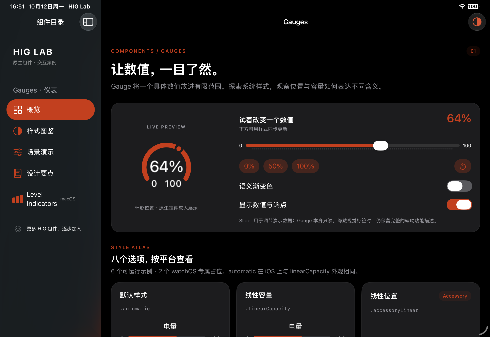

# HIG Lab

可运行的 SwiftUI Xcode 工程，逐步收录 Apple Human Interface Guidelines 的原生组件案例。第一期为 **Gauges**。

## 打开和运行

直接用 Xcode 打开 `HIGLab.xcodeproj`，无需先安装依赖或重新生成工程。

| Scheme | 平台 | 最低版本 |
| --- | --- | --- |
| `HIGLab` | iPhone / iPad | iOS / iPadOS 17 |
| `HIGLabMac` | Mac | macOS 14 |

选择 Scheme 与设备，然后按 **⌘R**。模拟器不需要配置开发者账号；真机运行需在 Signing & Capabilities 中选择自己的 Team。

## Gauge 案例

- **概览 / 样式图鉴**：八个 SwiftUI 内置样式选项，六个当前平台的原生示例，以及 `linear` / `circular` 两个 `watchOS only` 占位；统一的实时数值、0 / 50 / 100 预设、重置、标签与渐变开关，每个选项附可选择复制的代码。
- **场景演示**：温度区间 −10…40°C、低电量阈值、256 GB 存储容量；数据均为演示数据。
- **设计要点**：标签、单位、位置与容量、颜色语义、辅助功能、平台边界。
- **macOS 专属**：真实 `NSLevelIndicator` 的连续、离散、分层阈值及相关度呈现；每个案例附 AppKit 配置和完整 SwiftUI 桥接代码，支持一键复制。
- iPhone / iPad 也提供 Level Indicators 目录入口，展示 `macOS only` 占位；Mac 版本可用 25 / 72 / 95 预设比较阈值变化。
- 系统深浅色、Dynamic Type、自适应单列 / 多列、VoiceOver 数值和范围描述、减少动态效果支持。

`automatic` 与 `linearCapacity` 在 iOS 上会采用相同呈现。系统样式可随 OS 版本变化；这里使用原生 `Gauge`，没有自绘轨道。环形预览为了观察细节放大展示，图鉴使用原生尺寸。

`linear` 与 `circular` 仅适用于 watchOS，在 iOS / macOS 上展示明确的平台占位；代码弹窗同样注明平台限制。

Accessory 示例运行在 App 内；本工程未包含 WidgetKit、watchOS、visionOS extension。macOS 评分型指标由 HIG 的 Rating Indicators 单独讨论，留待后续组件加入。

## 工程结构与扩展

```text
HIGLab/
  HIGLabApp.swift                  App、组件目录、外观和导航
  Components/LabComponents.swift  卡片、标题、代码弹窗
  Gauges/
    GaugeStyleExample.swift       系统样式枚举与 Gauge 实例
    GaugeScreen.swift             概览、图鉴、交互控制
    GaugeScenariosView.swift      温度、电量和存储
    GaugeGuidelinesView.swift     HIG 设计要点
    LevelIndicatorsView.swift     macOS / AppKit 案例
HIGLabUITests/                    数值、代码弹窗和场景交互测试
project.yml                      XcodeGen 工程定义
```

未来组件可以按 `Gauges/` 的方式添加目录，并在 `CatalogView` 中注册对应导航。`project.yml` 与现有 Xcode 工程共同维护；新增文件后，如已安装 XcodeGen，可运行 `xcodegen generate` 更新工程。

## 验证

```bash
xcodebuild -project HIGLab.xcodeproj -scheme HIGLab \
  -destination 'platform=iOS Simulator,name=iPad Pro 11-inch (M5),OS=27.0' \
  -derivedDataPath .derivedData -collect-test-diagnostics never \
  CODE_SIGNING_ALLOWED=NO test

xcodebuild -project HIGLab.xcodeproj -scheme HIGLabMac \
  -derivedDataPath .derivedData/mac CODE_SIGNING_ALLOWED=NO build
```

UI 测试目前面向 iPad 横屏、侧边栏可见的布局。设备名称和 OS 版本应替换为本机可用的模拟器。

已于 2026-10-12 在 iPad Pro 11-inch (M5) / iOS 27.0 完成构建、安装、启动和 3 项 UI 测试；macOS target 构建通过。



## 参考

- [Apple HIG · Gauges](https://developer.apple.com/design/human-interface-guidelines/gauges)
- [SwiftUI · Gauge](https://developer.apple.com/documentation/swiftui/gauge)
- [AppKit · NSLevelIndicator](https://developer.apple.com/documentation/appkit/nslevelindicator)

界面中的指南内容是中文摘要；温度、电量和存储布局为本工程编写的交互示例。
