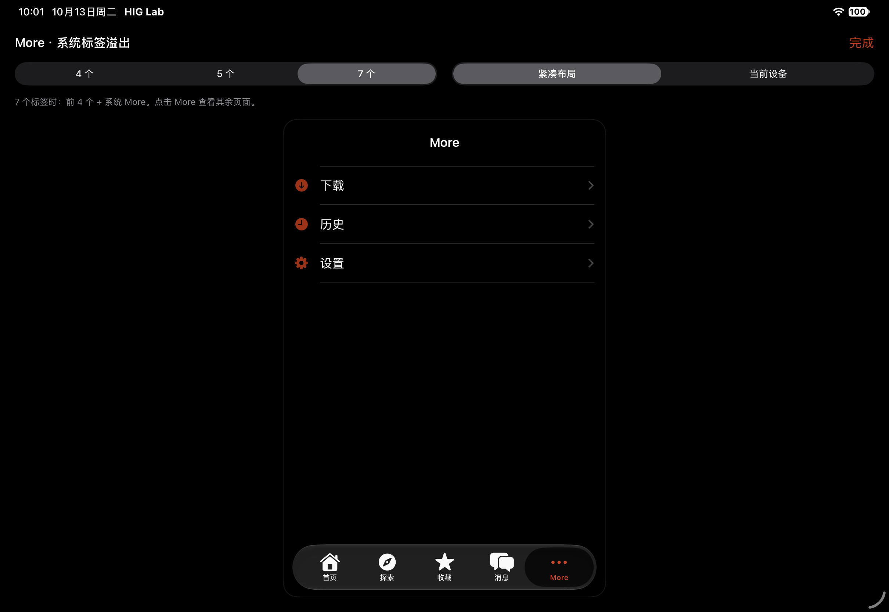
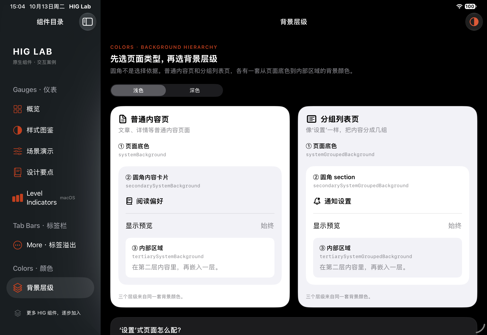
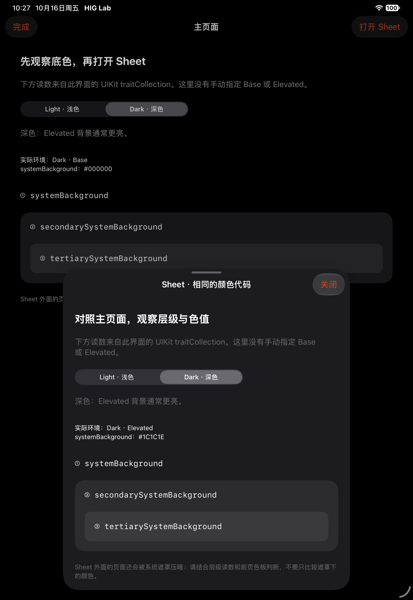
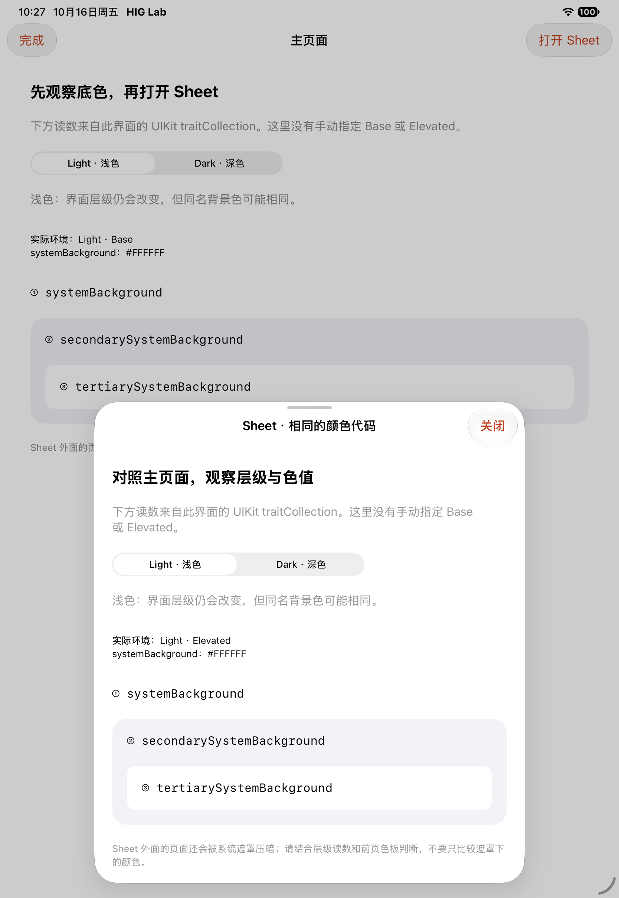
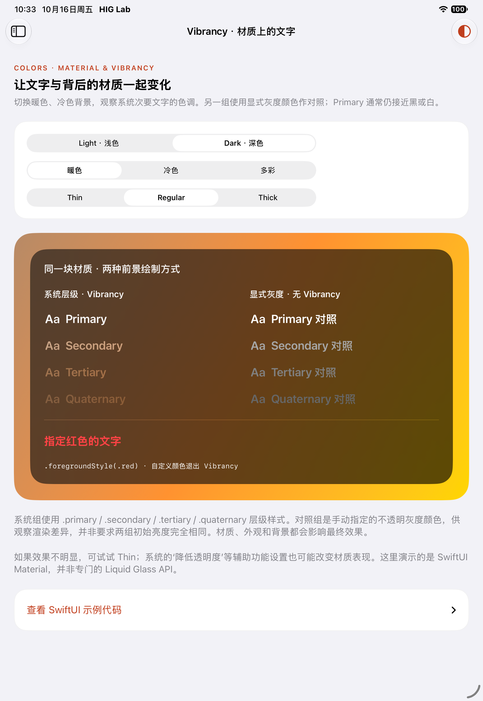
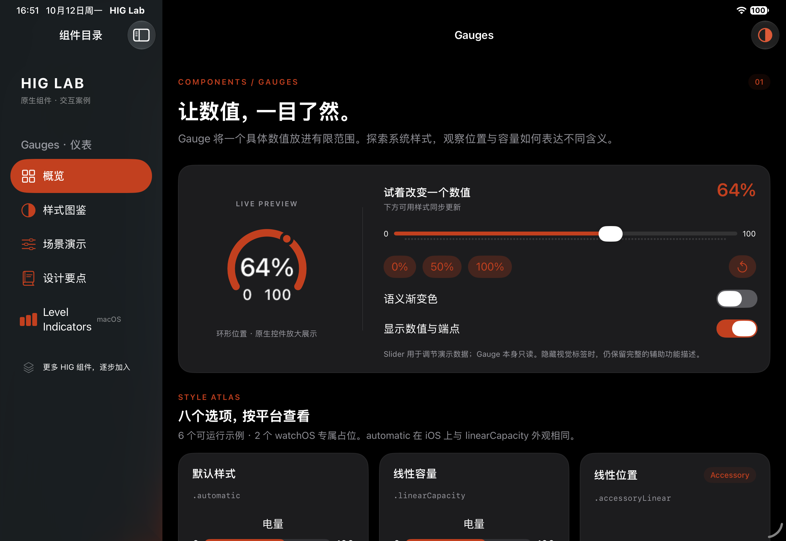

# HIG Lab

可运行的 SwiftUI Xcode 工程，逐步收录 Apple Human Interface Guidelines 的原生组件案例。第一期为 **Gauges**。

## Tab Bars · More

从组件目录进入 **Tab Bars → More · 标签溢出**，打开交互示例。使用真实 `UITabBarController` 的 7 个业务页面，紧凑布局下由系统显示前 4 个标签与 More 列表；可选择「下载、历史、设置」，也可切换 4 / 5 / 7 个标签与当前设备布局，比较是否发生溢出。iPad 常规布局可能在顶部显示全部标签。

案例附完整可复制代码。More 由系统自动生成，没有手动加入 `moreNavigationController`。macOS target 提供平台占位与代码。HIG 建议避免溢出，这个案例用于观察其行为。

已知行为：[iPad 窗口缩放后 More 出现 Edit 的说明](docs/tab-bar-more-edit-resize.md)。已在 iPadOS 27.0 复现，暂不修复。



## Colors · 背景层级

从组件目录进入 **Colors → 背景层级**，并排比较普通内容页的 `systemBackground` 系列和分组列表页的 `systemGroupedBackground` 系列。示例标出页面、圆角内容区域、内部区域三个层级，支持切换浅色 / 深色，并附可复制的 SwiftUI 代码。窄窗口下自动改为上下排列；macOS 展示 UIKit 平台说明和代码。

分组页面的整页底色使用 `systemGroupedBackground`，圆角 section 使用 `secondarySystemGroupedBackground`；圆角形状本身不决定使用哪套颜色。



## Colors · Base / Elevated

从组件目录进入 **Colors → Base / Elevated**。使用浅色 / 深色切换，令并排色板以所选外观、标准对比度分别解析 Base 和 Elevated 下的三个系统背景色；点击「打开主页面与 Sheet 演示」，观察系统在真实呈现环境中的自动调整。主页面和 Sheet 内也可以切换浅色 / 深色，选择会同步回色板；关闭演示后返回目录原有外观。

主页面与 Sheet 复用同一份背景布局，均使用 `systemBackground`、`secondarySystemBackground` 和 `tertiarySystemBackground`，没有覆盖界面层级。页面显示从 UIKit `traitCollection` 读取的实际层级及 `systemBackground` 色值，并附可复制的 SwiftUI 示例。macOS 提供平台说明和代码。

Base / Elevated 是界面呈现层级，与同一界面内部的 primary / secondary / tertiary 背景层级是两个维度。色板只用于受控比较；实际值以运行系统和呈现环境为准。Sheet 外面的页面会被系统遮罩压暗。

2026-10-16：iOS / macOS 构建通过。在 iPad Pro 11-inch (M5) / iPadOS 27.0 手动验证主页面为 Dark · Base（`#000000`），Sheet 为 Dark · Elevated（`#1C1C1E`）。

同日加入浅色切换并验证：主页面为 Light · Base，Sheet 为 Light · Elevated，两者 `systemBackground` 均为 `#FFFFFF`。Sheet 内切换深浅色会同步更新底层页面与实际层级读数。





## Colors · Vibrancy 材质文字

从 **Colors → Vibrancy · 材质文字** 进入。以真实 SwiftUI `Material` 为背景，对照 `.foregroundStyle(.primary / .secondary / .tertiary / .quaternary)` 与显式不透明灰度颜色，另有 `.red` 文字展示自定义颜色退出 Vibrancy。支持 Light / Dark、暖色 / 冷色 / 多彩背景、Thin / Regular / Thick 材质切换，窄窗口自动上下排列，附完整可复制代码。预览外观只作用于示例区域。

2026-10-16：iOS / macOS 构建通过。在 iPadOS 27.0 验证冷暖背景切换时系统次要文字的色调变化，并检查浅色、深色和材质厚度切换。



## App Shortcuts · Siri 提示卡片

从 **App Shortcuts → Siri 提示卡片** 进入。通过 `UIViewRepresentable` 嵌入真实 `SiriTipUIView`，关联 `CaptureIdeaIntent` 与 `HIGLabShortcuts`，由系统显示语音短语及关闭按钮。支持 Automatic / Light / Dark 样式、关闭后重新显示；「记录灵感」按钮执行同一个 Intent，在本地保存次数与最近时间。macOS 展示平台说明和代码。

触发短语为英文 **Capture an idea in HIG Lab**。该例用于观察系统提示，卡片本身不负责录音或识别语音。语音执行需要设备的 Siri 配置支持；也可在快捷指令 App 中找到 HIG Lab 的操作。页面包含可复制的 UIKit、App Intent 和 App Shortcut 示例。

2026-11-02：iOS Simulator 与 macOS 构建通过，并检查生成的 App Intents 元数据。原 iPad / iOS 27.0 runtime 不可用；随后通过 Device Hub 在用户选择的 iPhone 18 Pro / iOS 27.2 安装运行成功（该环境由 Device Hub 提供模拟器界面）。SiriTipUIView 的样式、关闭交互与 Siri 语音执行尚未实测；下方两个新增示例已完成所列运行验证。

## App Shortcuts · Snippet 结果卡片

从 **App Shortcuts → Snippet · 结果卡片** 进入。点击「记录灵感并预览结果」执行 `CaptureIdeaSnippetIntent`，与 Siri 提示卡片的示例共用本地灵感计数。Intent 返回 `ProvidesDialog & ShowsSnippetView`，其中 `IdeaSnippetView` 显示成功状态、累计数量与记录时间。页面包含可复制代码。

App 内展示明确标注的内容预览；它不会自行打开 Siri 浮层。要验证系统展示，打开「快捷指令」侧边目录 → **App → HIG Lab → 记录灵感并显示结果** 直接运行（已实测），也可添加到自己的快捷指令；或使用英文 Siri 短语 **Capture an idea with a snippet in HIG Lab**。不同系统入口决定是否呈现自定义视图；Apple 文档提示 Siri AI 可能不显示 `IntentDialog` / `ShowsSnippetView`。本例为静态结果，不包含交互式 Snippet。

## App Shortcuts · Live Activity 专注倒计时

从 **App Shortcuts → Live Activity · 专注** 进入。选择 1 / 5 / 25 分钟，点击「开始实时活动」，然后锁定设备查看系统卡片。在支持灵动岛的 iPhone 上，返回主屏幕可观察紧凑布局，长按展开；系统在适当场景使用最小布局。iPad 可看锁屏活动，没有 iPhone 的灵动岛。

- **加 1 分钟**：通过 `Activity.update` 更新结束时间；**结束并移除**：通过 `Activity.end` 立即移除。
- 重新打开 App 会恢复当前活动；点击系统卡片通过 `higlab://live-activity` 返回本页。已有活动时复用，不重复创建。
- 快捷指令操作 **开始专注倒计时** / 英文短语 **Start a focus timer in HIG Lab** 使用 `LiveActivityIntent`，默认启动五分钟，或恢复已有活动。
- `HIGLabLiveActivities` 是实际嵌入 App 的 Widget 扩展，包含锁屏及灵动岛紧凑 / 展开 / 最小布局。打开其 Swift 文件可在 Xcode Canvas 选择四种 `#Preview`；`IdeaSnippet.swift` 也提供结果视图预览。
- `Text(timerInterval:)` 由系统刷新，无需 App 每秒运行。计时归零和 `staleDate` **不会自动结束活动**；本地示例需要手动结束，没有接入后台推送或服务器。

App 内提供内容预览、生命周期、Widget 布局及 `LiveActivityIntent` 代码。macOS 目录保留说明和代码，实际 ActivityKit 操作在 iOS target 中。

2026-11-02：iOS App + Widget 扩展、macOS target 构建通过；App Intents 元数据包含三个操作，App 包含 `.appex`、`NSSupportsLiveActivities` 和 URL Scheme。改用用户选择的 **iPhone 18 Pro / iOS 27.2** 后，构建、安装和启动成功，通过 Device Hub 手动验证：

- App 内记录灵感后显示累计 1 个；通过系统「快捷指令」运行后，真正的 Snippet 浮层显示累计 2 个、记录时间及系统 Done 按钮。
- 实时活动开始、加时（目标结束时间从 17:31 变为 17:32）、切后台后的灵动岛紧凑布局、长按展开布局、锁屏卡片和首次系统允许提示。
- 点击锁屏卡片回到专注页；结束后页面恢复「尚未开始」，返回主屏幕确认灵动岛活动消失。
- 系统「快捷指令」中的「开始专注倒计时」可以创建新的五分钟活动并打开专注页。

尚未验证 Siri 语音、灵动岛最小布局、Canvas 或真机行为。

| Snippet 系统结果 | Live Activity 系统展示 |
| --- | --- |
| [系统结果卡片](Screenshots/snippet-system-iphone.png) · [App 内预览](Screenshots/snippet-preview-iphone.png) | [锁屏](Screenshots/live-activity-lockscreen-iphone.png) · [灵动岛紧凑](Screenshots/live-activity-compact-iphone.png) · [灵动岛展开](Screenshots/live-activity-expanded-iphone.png) |

参考：[Apple · Snippet 实现](https://developer.apple.com/documentation/appintents/displaying-static-and-interactive-snippets)、[Apple · Live Activity 实现](https://developer.apple.com/documentation/activitykit/displaying-live-data-with-live-activities)。

## 打开和运行

直接用 Xcode 打开 `HIGLab.xcodeproj`，无需先安装依赖或重新生成工程。

| Scheme | 平台 | 最低版本 |
| --- | --- | --- |
| `HIGLab` | iPhone / iPad | iOS / iPadOS 17 |
| `HIGLabMac` | Mac | macOS 14 |

选择 Scheme 与设备，然后按 **⌘R**。模拟器不需要配置开发者账号；真机运行需为 App 与 `HIGLabLiveActivities` 扩展选择同一个 Team，并按需修改这两个 target 的 Bundle ID（扩展须以 App 的 Bundle ID 为前缀）。

## Gauge 案例

- **概览 / 样式图鉴**：八个 SwiftUI 内置样式选项，六个当前平台的原生示例，以及 `linear` / `circular` 两个 `watchOS only` 占位；统一的实时数值、0 / 50 / 100 预设、重置、标签与渐变开关，每个选项附可选择复制的代码。
- **场景演示**：温度区间 −10…40°C、低电量阈值、256 GB 存储容量；数据均为演示数据。
- **设计要点**：标签、单位、位置与容量、颜色语义、辅助功能、平台边界。
- **macOS 专属**：真实 `NSLevelIndicator` 的连续、离散、分层阈值及相关度呈现；每个案例附 AppKit 配置和完整 SwiftUI 桥接代码，支持一键复制。
- iPhone / iPad 也提供 Level Indicators 目录入口，展示 `macOS only` 占位；Mac 版本可用 25 / 72 / 95 预设比较阈值变化。
- 系统深浅色、Dynamic Type、自适应单列 / 多列、VoiceOver 数值和范围描述、减少动态效果支持。

`automatic` 与 `linearCapacity` 在 iOS 上会采用相同呈现。系统样式可随 OS 版本变化；这里使用原生 `Gauge`，没有自绘轨道。环形预览为了观察细节放大展示，图鉴使用原生尺寸。

`linear` 与 `circular` 仅适用于 watchOS，在 iOS / macOS 上展示明确的平台占位；代码弹窗同样注明平台限制。

Gauge Accessory 示例运行在 App 内；WidgetKit 扩展目前仅用于专注实时活动，本工程未包含 watchOS、visionOS extension。macOS 评分型指标由 HIG 的 Rating Indicators 单独讨论，留待后续组件加入。

## 工程结构与扩展

```text
HIGLab/
  HIGLabApp.swift                  App、组件目录、外观和导航
  Components/LabComponents.swift  卡片、标题、代码弹窗
  AppShortcuts/                  Siri 提示、App Intents、Snippet 结果视图
  LiveActivities/                倒计时控制页与 ActivityKit 生命周期
  Gauges/
    GaugeStyleExample.swift       系统样式枚举与 Gauge 实例
    GaugeScreen.swift             概览、图鉴、交互控制
    GaugeScenariosView.swift      温度、电量和存储
    GaugeGuidelinesView.swift     HIG 设计要点
    LevelIndicatorsView.swift     macOS / AppKit 案例
Shared/FocusActivityAttributes.swift  App / Widget 共用的状态与倒计时内容视图
HIGLabLiveActivities/             Widget 扩展：锁屏、灵动岛与四种 Canvas 预览
HIGLabUITests/                    数值、代码弹窗和场景交互测试
project.yml                      XcodeGen 工程定义
```

未来组件可以按 `Gauges/` 的方式添加目录，并在 `CatalogView` 中注册对应导航。`project.yml` 与现有 Xcode 工程共同维护；新增文件后，如已安装 XcodeGen，可运行 `xcodegen generate` 更新工程。

## 验证

```bash
xcodebuild -project HIGLab.xcodeproj -scheme HIGLab \
  -destination 'platform=iOS Simulator,name=iPad Pro 11-inch (M5),OS=27.0' \
  -derivedDataPath .derivedData -collect-test-diagnostics never \
  CODE_SIGNING_ALLOWED=NO test

xcodebuild -project HIGLab.xcodeproj -scheme HIGLabMac \
  -derivedDataPath .derivedData/mac CODE_SIGNING_ALLOWED=NO build
```

UI 测试目前面向 iPad 横屏、侧边栏可见的布局。设备名称和 OS 版本应替换为本机可用的模拟器。

已于 2026-10-12 在 iPad Pro 11-inch (M5) / iOS 27.0 完成构建、安装、启动和 3 项 UI 测试；macOS target 构建通过。

2026-10-13 新增 Tab Bars 案例后，4 项 UI 测试全部通过，包含系统 More 自动出现、打开溢出页面以及减少标签后消失；两个平台构建及 Tab Bars 完整代码示例编译检查通过。

同日新增 Colors 背景层级案例，iOS / macOS 构建通过，已在 iPadOS 27.0 手动验证浅色 / 深色切换。



## 参考

- [Apple HIG · Gauges](https://developer.apple.com/design/human-interface-guidelines/gauges)
- [Apple HIG · Tab bars](https://developer.apple.com/design/human-interface-guidelines/tab-bars)
- [SwiftUI · Gauge](https://developer.apple.com/documentation/swiftui/gauge)
- [AppKit · NSLevelIndicator](https://developer.apple.com/documentation/appkit/nslevelindicator)

界面中的指南内容是中文摘要；温度、电量和存储布局为本工程编写的交互示例。
